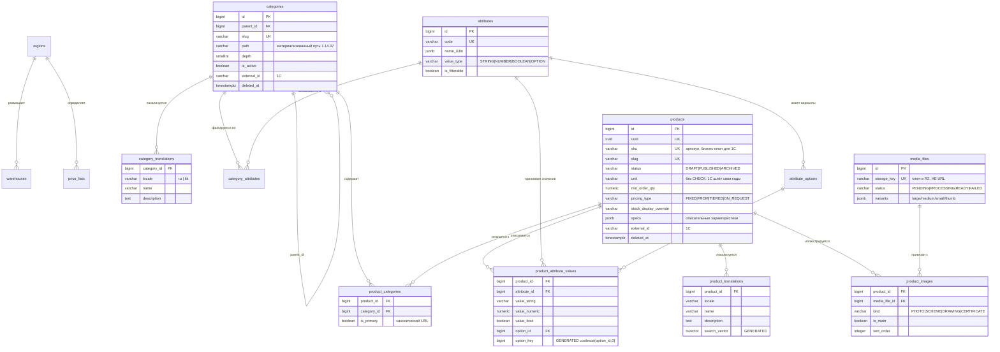
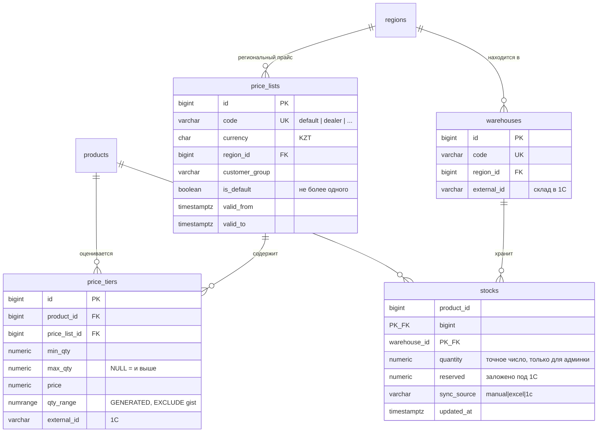
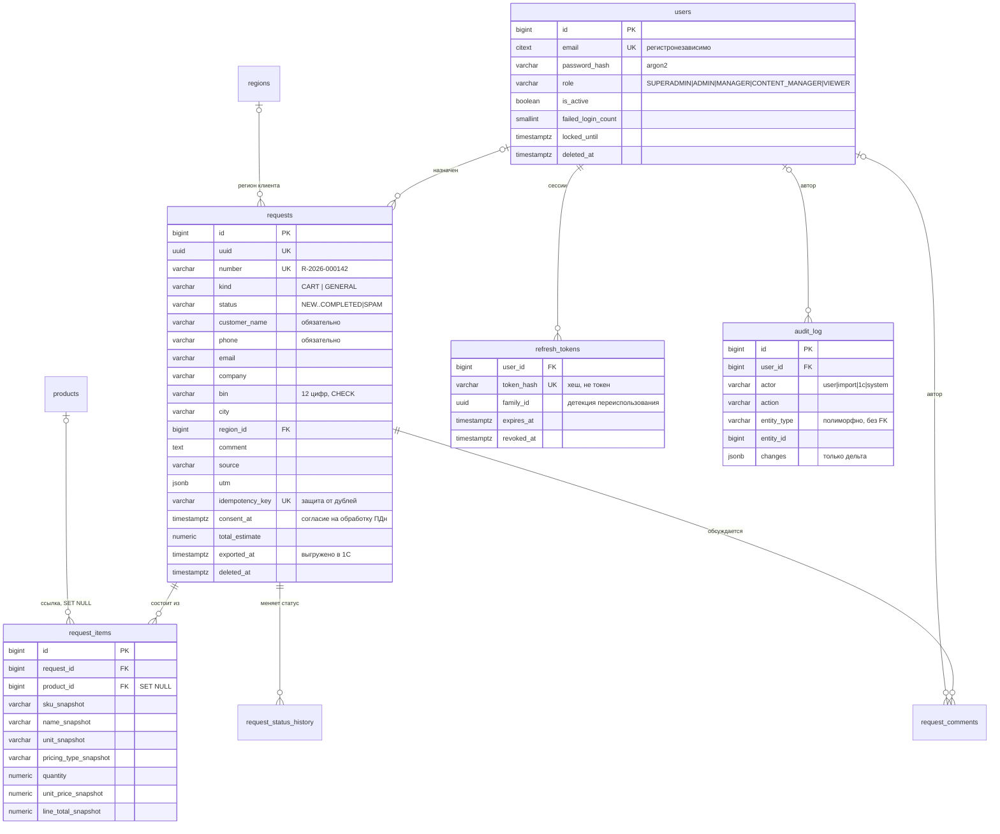

# OINAU-PRO — структура базы данных

**Ревизия схемы:** `02b0358003e8` (initial schema)
**СУБД:** PostgreSQL 16
**Таблиц:** 23 (+ `alembic_version`)

Обоснования решений — в `docs/architecture.md`, разделы 4–6.
Модели — в `apps/backend/app/modules/*/models.py`.

---

## 1. Соглашения, действующие во всей схеме

| Правило                  | Реализация                                                              |
| ------------------------ | ----------------------------------------------------------------------- |
| Деньги                   | `NUMERIC(14,2)`. Никогда `float`                                        |
| Количество               | `NUMERIC(14,3)`. Канат меряется метрами, крепёж — килограммами          |
| Время                    | `TIMESTAMPTZ`, хранение в UTC, конвертация в `Asia/Almaty` на фронте    |
| Первичные ключи          | `BIGINT`, автоинкремент                                                 |
| Публичные идентификаторы | `uuid` рядом с `id` там, где ID утекает наружу                          |
| Статусы                  | `VARCHAR` + `CHECK`, а не `ENUM` PostgreSQL                             |
| Удаление                 | `deleted_at` для товаров, категорий, заявок, пользователей              |
| Именование ограничений   | `naming_convention` в `MetaData`, без автоимён                          |
| Подготовка к 1С          | `external_id`, `sync_source`, `synced_at` на синхронизируемых сущностях |

---

## 2. ER-диаграммы

### 2.1 Каталог



### 2.2 Цены и остатки



### 2.3 Заявки, пользователи, аудит



---

## 3. Справочник таблиц

| #   | Таблица                    | Назначение                                                                                                                                               | Мягкое удаление    |
| --- | -------------------------- | -------------------------------------------------------------------------------------------------------------------------------------------------------- | ------------------ |
| 1   | `regions`                  | Регионы работы. Алматы — строка, не константа                                                                                                            | `is_active`        |
| 2   | `users`                    | Сотрудники админки                                                                                                                                       | `deleted_at`       |
| 3   | `refresh_tokens`           | Сессии обновления токенов                                                                                                                                | `revoked_at`       |
| 4   | `categories`               | Дерево категорий                                                                                                                                         | `deleted_at`       |
| 5   | `category_translations`    | Локализация категорий                                                                                                                                    | каскад от родителя |
| 6   | `products`                 | Товары                                                                                                                                                   | `deleted_at`       |
| 7   | `product_translations`     | Локализация + `search_vector`                                                                                                                            | каскад             |
| 8   | `product_categories`       | Связь M:N с признаком основной                                                                                                                           | каскад             |
| 9   | `attributes`               | Справочник фильтруемых характеристик                                                                                                                     | `is_active`        |
| 10  | `attribute_options`        | Варианты значений                                                                                                                                        | каскад             |
| 11  | `category_attributes`      | Какие фильтры в какой категории                                                                                                                          | каскад             |
| 12  | `product_attribute_values` | Значения характеристик товара                                                                                                                            | каскад             |
| 13  | `media_files`              | Метаданные файлов в R2                                                                                                                                   | `status`           |
| 14  | `product_images`           | Привязка файлов к товару                                                                                                                                 | каскад             |
| 15  | `price_lists`              | Прайс-листы                                                                                                                                              | `is_active`        |
| 16  | `price_tiers`              | Ценовые ступени по количеству                                                                                                                            | каскад             |
| 17  | `warehouses`               | Склады                                                                                                                                                   | `is_active`        |
| 18  | `stocks`                   | Текущий остаток (товар × склад)                                                                                                                          | каскад             |
| 19  | `requests`                 | Заявки: CART и GENERAL                                                                                                                                   | `deleted_at`       |
| 20  | `request_items`            | Позиции со снапшотом                                                                                                                                     | каскад             |
| 21  | `request_comments`         | Комментарии менеджеров                                                                                                                                   | каскад             |
| 22  | `request_status_history`   | История смены статусов                                                                                                                                   | каскад             |
| 23  | `audit_log`                | Журнал изменений                                                                                                                                         | не удаляется       |
| 24  | `import_jobs`              | История Excel-импортов каталога (этап 5E): метаданные файла, итог проверки, ошибки JSONB. Сам файл не хранится — см. `docs/api-catalog-import-export.md` | не удаляется       |

### Где `deleted_at`, а где `is_active`

Это разные вещи, и путаница между ними — источник багов.

**`deleted_at`** — «этой сущности больше нет, но на неё ссылается история».
Нужен там, где на строку ссылаются документы: товары и категории
(упомянуты в заявках), заявки (коммерческие документы), пользователи
(авторы комментариев и записей аудита). Частичные уникальные индексы
`WHERE deleted_at IS NULL` позволяют переиспользовать освободившийся
артикул или slug.

**`is_active`** — «сущность существует, но временно не используется».
Достаточно для справочников, которые не удаляют, а выключают: регионы,
склады, прайс-листы, характеристики.

Обоих полей одновременно нет нигде, кроме `products` и `categories`, где
они означают разное: `is_active` — товар скрыт с витрины, `deleted_at` —
товар удалён из каталога. У `products` есть ещё `status`, отвечающий за
этап публикации.

Связующие таблицы (`product_categories`, `category_attributes`,
`product_attribute_values`, `stocks`) удаляются жёстко: они не являются
самостоятельными сущностями и не участвуют в истории.

---

## 4. Ограничения целостности

Всего: **23 PRIMARY KEY, 30 FOREIGN KEY, 26 CHECK, 4 UNIQUE, 1 EXCLUDE.**

### 4.1 EXCLUDE — защита от пересечения ценовых ступеней

```sql
ALTER TABLE price_tiers ADD CONSTRAINT no_overlapping_tiers
  EXCLUDE USING gist (
    product_id WITH =, price_list_id WITH =, qty_range WITH &&
  );
```

`qty_range` — генерируемая колонка `numrange(min_qty, max_qty, '[]')`.
Границы включающие, поэтому `[1,9]` и `[10,49]` соседние, а не
пересекающиеся.

**Почему это оправдано именно здесь.** Цены будут править менеджеры
через админку, Excel-импорт и, в перспективе, 1С. Любой из трёх
источников способен создать ступени `[1,50]` и `[40,100]`, после чего
`resolve_price(product, 45)` вернёт произвольную из двух цен. Проверка
в коде приложения не защищает от конкурентных транзакций: две
одновременные вставки пройдут валидацию по отдельности. Расхождение
всплывёт в споре с клиентом через месяцы.

Это единственное место в схеме, где используется `btree_gist`.

### 4.2 CHECK — прочие важные

| Таблица                    | Ограничение             | Что предотвращает                                                      |
| -------------------------- | ----------------------- | ---------------------------------------------------------------------- |
| `product_attribute_values` | `num_nonnulls(...) = 1` | Значение характеристики заполнено ровно в одной типизированной колонке |
| `categories`               | `parent_id <> id`       | Категория — сама себе родитель                                         |
| `requests`                 | `bin ~ '^[0-9]{12}$'`   | Мусор в поле БИН                                                       |
| `requests`                 | `length(phone) >= 5`    | Пустой телефон при обязательном контакте                               |
| `price_tiers`              | `max_qty >= min_qty`    | Диапазон наизнанку                                                     |
| `stocks`                   | `quantity >= 0`         | Отрицательный остаток                                                  |
| `products` и др.           | `status IN (...)`       | Неизвестный статус из импорта                                          |

### 4.3 Частичные уникальные индексы

20 индексов имеют условие `WHERE`. Ключевые:

| Индекс                          | Условие                   | Смысл                                                                |
| ------------------------------- | ------------------------- | -------------------------------------------------------------------- |
| `uq_products_sku`               | `deleted_at IS NULL`      | Артикул уникален среди живых товаров                                 |
| `uq_products_slug`              | `deleted_at IS NULL`      | То же для URL                                                        |
| `uq_products_external_id`       | `external_id IS NOT NULL` | Один объект 1С — одна карточка; при этом `NULL` у всех до интеграции |
| `uq_users_email`                | `deleted_at IS NULL`      | Уволенный не блокирует повторное заведение                           |
| `uq_product_categories_primary` | `is_primary`              | Одна основная категория на товар                                     |
| `uq_product_images_main`        | `is_main`                 | Одна обложка                                                         |
| `uq_price_lists_default`        | `is_default`              | Один прайс по умолчанию                                              |
| `uq_requests_idempotency_key`   | `IS NOT NULL`             | Защита от дублей, но не мешает заявкам без ключа                     |

---

## 5. Индексы

Всего 88 индексов (включая PK и уникальные). Каждый добавлен под
конкретный запрос — «на всякий случай» индексов нет, они замедляют
запись и раздувают базу.

| Назначение                               | Индекс                                                                  |
| ---------------------------------------- | ----------------------------------------------------------------------- |
| Витрина: активные опубликованные товары  | `ix_products_published (status, is_active) WHERE deleted_at IS NULL`    |
| Поиск по части артикула                  | `ix_products_sku_trgm` GIN + `gin_trgm_ops`                             |
| Полнотекстовый поиск                     | `ix_product_translations_search` GIN по `search_vector`                 |
| Поиск по названию с опечатками           | `ix_product_translations_name_trgm` GIN + `gin_trgm_ops`                |
| Ветка дерева категорий                   | `ix_categories_path` с `varchar_pattern_ops` (для `path LIKE '1.14.%'`) |
| Товары категории                         | `ix_product_categories_category_id`                                     |
| Фасетные фильтры                         | `ix_product_attribute_values_option (attribute_id, option_id)`          |
| Числовые фильтры («диаметр от 10 до 20») | `ix_product_attribute_values_numeric (attribute_id, value_numeric)`     |
| Подбор цены                              | `ix_price_tiers_lookup (product_id, price_list_id, min_qty)`            |
| Наличие                                  | `ix_stocks_available (product_id) WHERE quantity > 0`                   |
| Главный экран админки                    | `ix_requests_status_created (status, created_at DESC)`                  |
| Лента заявок                             | `ix_requests_created_at (created_at DESC)`                              |
| Разделы «Заявки» / «Лиды»                | `ix_requests_kind_status (kind, status)`                                |
| Заявки менеджера                         | `ix_requests_assigned_to_id WHERE NOT NULL`                             |
| Будущая выгрузка в 1С                    | `ix_requests_pending_export (created_at) WHERE exported_at IS NULL`     |
| Состав заявки                            | `ix_request_items_request_id`                                           |
| Аналитика спроса                         | `ix_request_items_product_id`, `ix_request_items_sku`                   |
| История объекта                          | `ix_audit_log_entity (entity_type, entity_id, created_at DESC)`         |
| Уборка брошенных загрузок                | `ix_media_files_status_created`                                         |
| Сопоставление с 1С                       | `uq_*_external_id` на товарах, категориях, складах, регионах, ступенях  |

### Генерируемые колонки

PostgreSQL поддерживает их сам — рассинхронизация невозможна в принципе,
включая массовые `UPDATE` из будущего импорта. Триггеры для этого не нужны.

| Колонка                               | Выражение                          |
| ------------------------------------- | ---------------------------------- |
| `product_translations.search_vector`  | `to_tsvector('russian', name       |     | ' ' |     | short_description)` |
| `price_tiers.qty_range`               | `numrange(min_qty, max_qty, '[]')` |
| `product_attribute_values.option_key` | `coalesce(option_id, 0)`           |

---

## 6. Расширения PostgreSQL

Новых расширений не добавлено. Используются только заложенные на этапе 2,
и каждое — под конкретную задачу:

| Расширение   | Где реально используется                                                                 |
| ------------ | ---------------------------------------------------------------------------------------- |
| `pgcrypto`   | `gen_random_uuid()` в `products.uuid`, `requests.uuid`, `media_files.uuid`, `users.uuid` |
| `citext`     | `users.email` — регистронезависимая уникальность                                         |
| `pg_trgm`    | Поиск по части артикула и названия с опечатками                                          |
| `btree_gist` | `EXCLUDE` на пересечение ценовых ступеней                                                |
| `unaccent`   | Зарезервировано для нормализации поисковых запросов (этап 7)                             |

`ltree` не подключался: материализованный путь `VARCHAR` с
`varchar_pattern_ops` решает ту же задачу без нового расширения.

Расширения создаются **внутри миграции**, а не только в
`infra/docker/postgres/init.sql`: последний выполняется единственный раз
при инициализации тома Docker, поэтому в CI и на новом сервере его нет.
Миграция обязана разворачиваться на чистой базе самостоятельно.

---

## 7. Модель i18n

Применены два разных подхода, и это осознанно.

**Отдельные таблицы переводов** — `product_translations`,
`category_translations`. Критерий: поле участвует в полнотекстовом
поиске, в SEO или содержит длинный текст. По JSONB нельзя построить
`tsvector`-индекс на конкретный язык, а поиск — основная функция
каталога.

**JSONB `*_i18n`** — `attributes.name_i18n`,
`attribute_options.value_i18n`, `product_images.alt_i18n`. Критерий:
короткая подпись из небольшого справочника, которая никогда не ищется
и всегда читается целиком вместе с родительской строкой. Отдельная
таблица дала бы лишний JOIN в самом горячем запросе витрины — отрисовке
блока фильтров — ради нулевого выигрыша.

`locale` намеренно **без** `CHECK`-ограничения: добавление казахского
не должно требовать миграции. Допустимые значения проверяются
приложением по настройке `SUPPORTED_LOCALES`.

---

## 8. Подготовка к 1С

Реализована только схема. Кода интеграции нет.

| Что заложено                      | Где                                                                                         |
| --------------------------------- | ------------------------------------------------------------------------------------------- |
| `external_id` (GUID объекта 1С)   | `products`, `categories`, `warehouses`, `regions`, `price_lists`, `price_tiers`, `requests` |
| Уникальность при наличии значения | Частичные индексы `WHERE external_id IS NOT NULL`                                           |
| `sku` как бизнес-ключ             | `products.sku` — сопоставление до простановки GUID                                          |
| Кто последний записал             | `sync_source`: `manual` / `excel` / `1c`                                                    |
| Время синхронизации               | `synced_at` — для инкрементального обмена                                                   |
| Дробные количества                | `NUMERIC` в `stocks`, `price_tiers`, `request_items`                                        |
| Единица измерения без CHECK       | `products.unit` — 1С может прислать незнакомый код                                          |
| Выгрузка заявок                   | `requests.external_id`, `requests.exported_at` + индекс `ix_requests_pending_export`        |
| Склады 1С                         | `warehouses.external_id`                                                                    |

Матрица владения полями (кто мастер для чего) — раздел 7.2 в
`docs/architecture.md`. Её нужно зафиксировать письменно до начала
интеграции, иначе обе системы будут затирать данные по кругу.

---

## 9. Что сознательно не сделано

| Не сделано                             | Почему                                                                                                              |
| -------------------------------------- | ------------------------------------------------------------------------------------------------------------------- |
| `stock_movements` (регистр движений)   | Источником истины по остаткам будет 1С. Параллельный регистр = второй источник правды и гарантированные расхождения |
| История цен отдельной таблицей         | `audit_log` покрывает потребность. Полноценная история версий добавляется позже без изменения схемы                 |
| Таблицы `roles` / `permissions`        | Пять ролей в одной компании. Права — константы в коде, см. `app/modules/users/permissions.py`                       |
| Партиционирование `audit_log`          | При 100–200 заявках в день таблица не вырастет до размеров, требующих партиций, годами                              |
| `customers` (кабинет B2B)              | Кабинет не нужен на старте. Отдельная таблица, а не расширение `users`                                              |
| `notification_outbox`                  | Относится к этапу 8                                                                                                 |
| `settings`, `pages`, `banners`, `faqs` | Контентные сущности, этап 12                                                                                        |
| `import_job_errors`                    | Ошибки импорта хранятся в `import_jobs.errors` (JSONB, до 500 записей): их читают только целиком вместе с импортом  |
| `api_keys`                             | Интеграционный API, этап 16                                                                                         |
